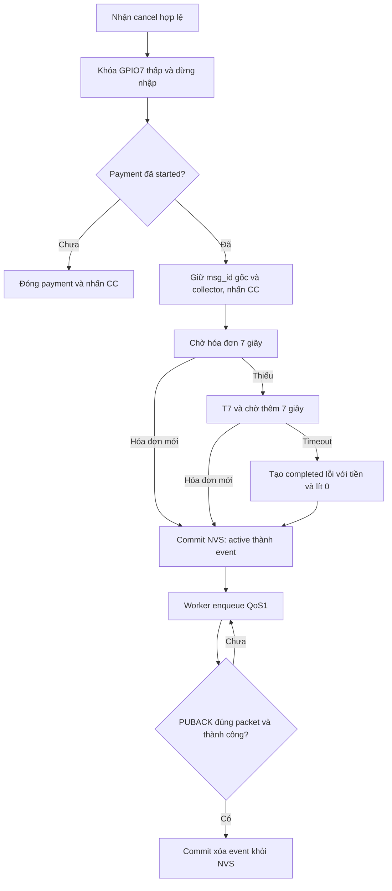

# Luồng runtime

ACK cancel được gửi sau khi tạo task CC, không đợi hóa đơn. Nếu hóa đơn đến trong khi CC đang nhấn, kết quả vẫn được lưu. Reboot nạp lại journal: gửi các event tồn đọng và phục hồi payment started với GPIO7 thấp. Command mới bị chặn khi đang phục hồi hoặc queue đầy.
