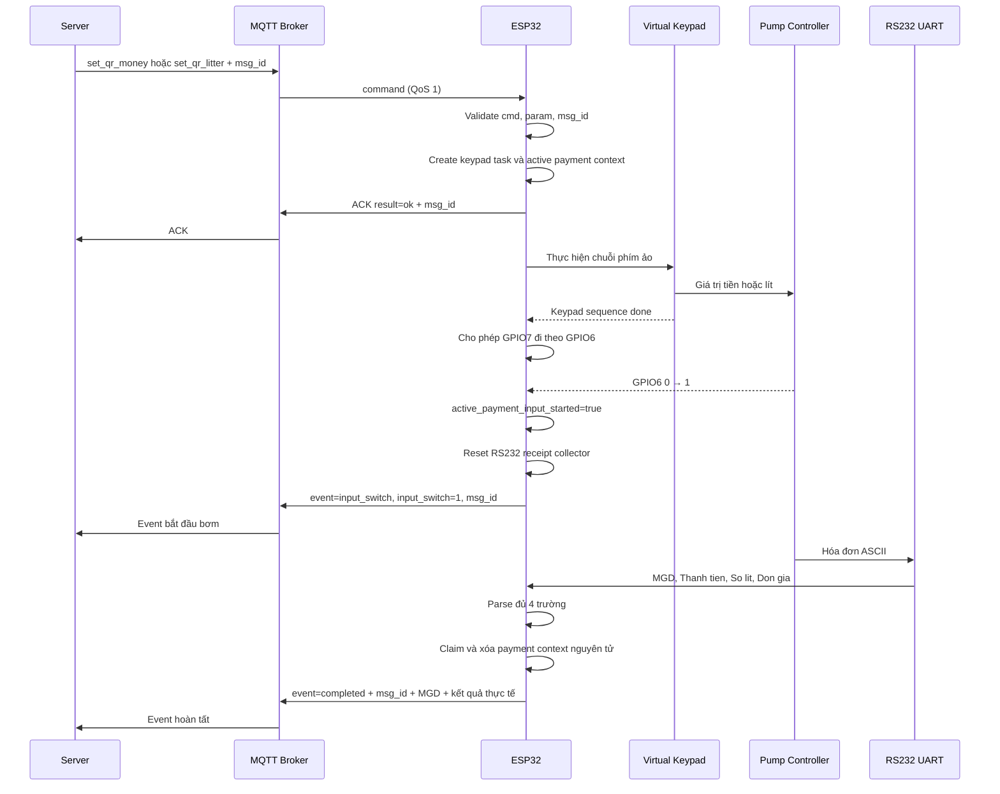
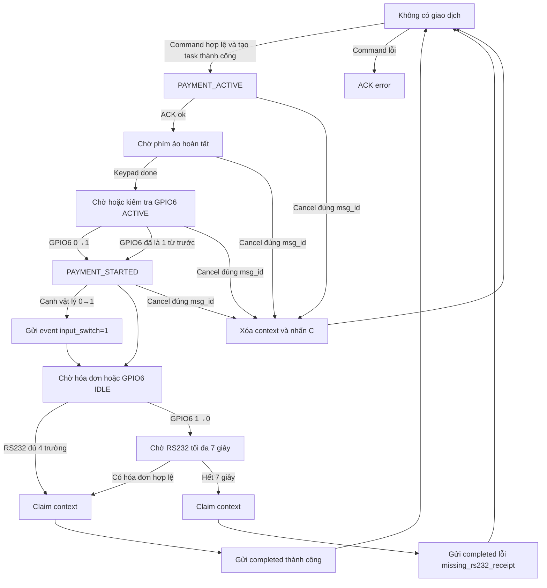
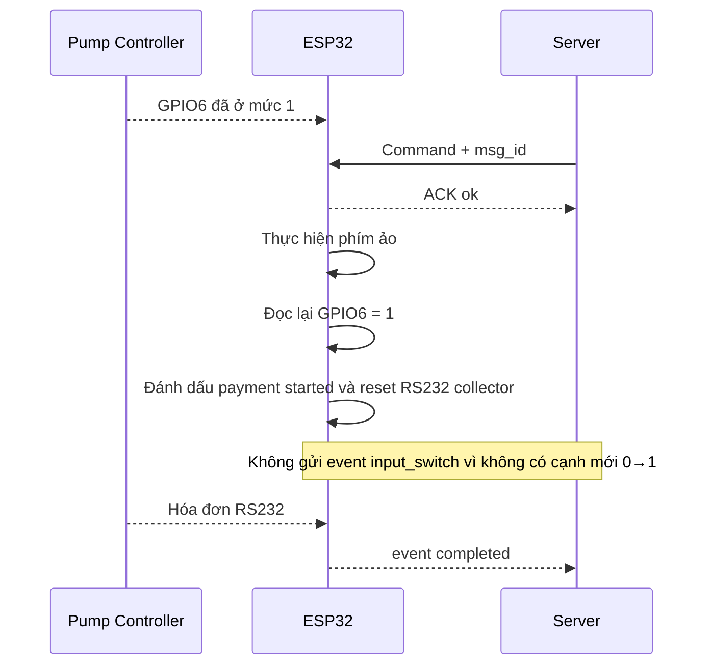
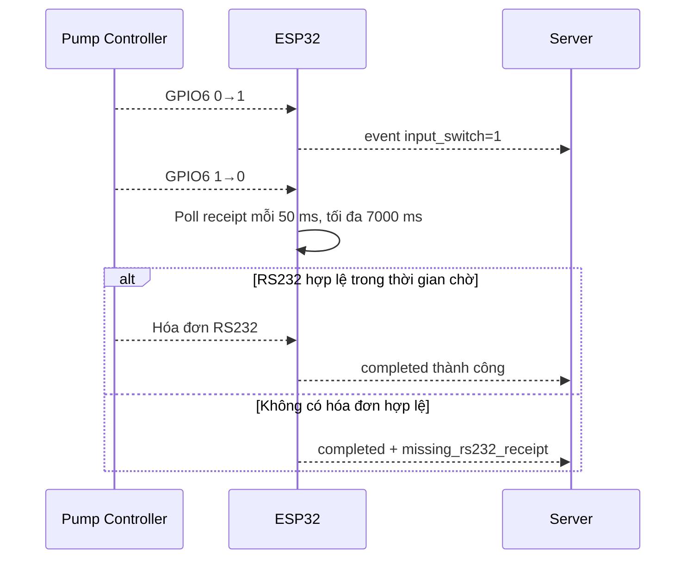
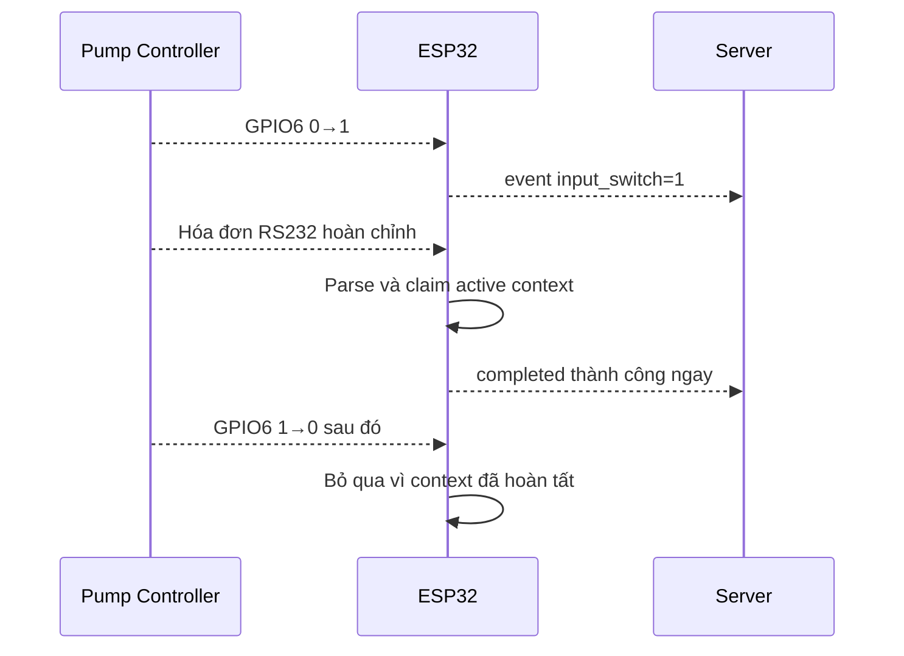
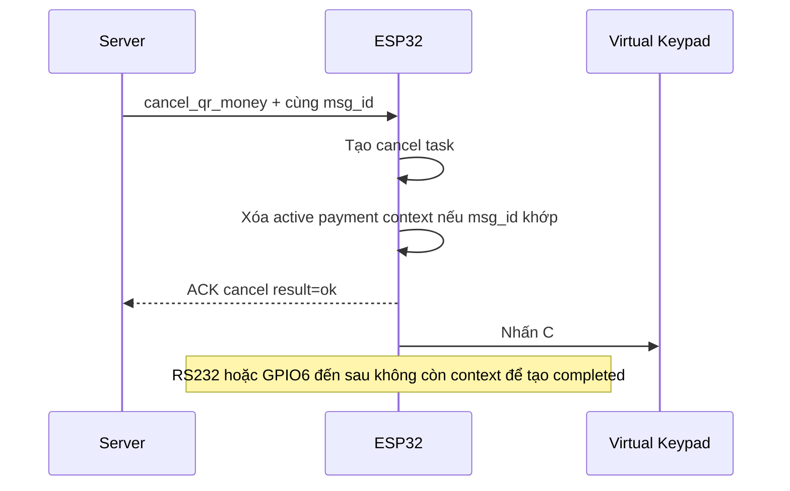

# Luồng giao dịch và MQTT event

## 1. Luồng thành công chuẩn

Ghi chú:

1. ACK `ok` chỉ xác nhận task đã được tạo.
2. GPIO6 ACTIVE là bằng chứng giao dịch đã bắt đầu.
3. Hóa đơn hợp lệ có thể hoàn tất giao dịch ngay, không cần chờ GPIO6 xuống `0`.
4. Claim context bảo đảm chỉ một đường được quyền gửi kết quả.

## 2. State machine

## 3. GPIO6 đã ACTIVE trước command

Điểm quan trọng: trạng thái `1` có sẵn vẫn thỏa điều kiện bắt đầu giao dịch, nhưng không được giả thành một cạnh mới để gửi event `input_switch`.

## 4. GPIO6 về IDLE trước khi hóa đơn tới

## 5. Hóa đơn tới trước GPIO6 IDLE

## 6. Luồng cancel

## 7. Quy tắc phía server

1. Đọc danh tính thiết bị từ topic `{gw_pay}/{node_pay}`.
2. Dùng `msg_id` để nối command → ACK → input-switch event → completed event.
3. Không đánh dấu giao dịch hoàn tất chỉ dựa trên ACK.
4. Chỉ event `completed` mới là kết quả cuối.
5. Xử lý QoS 1 theo hướng idempotent vì message có thể lặp.
6. Không dùng riêng `MGD` làm khóa toàn hệ thống.
